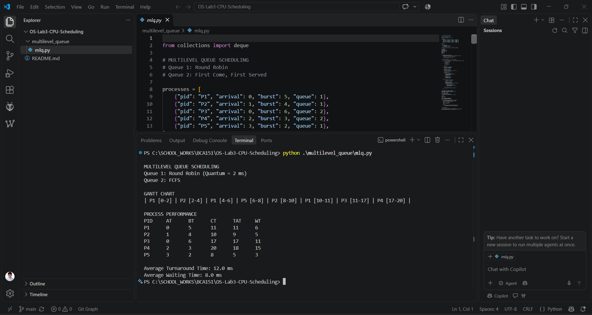
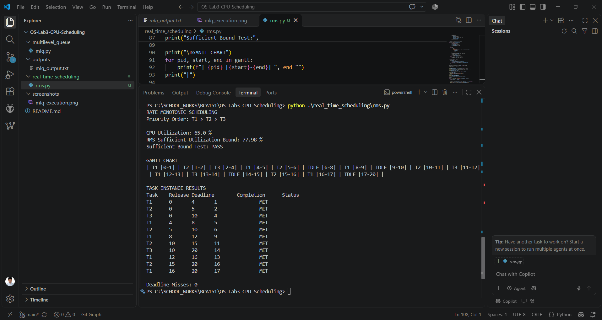
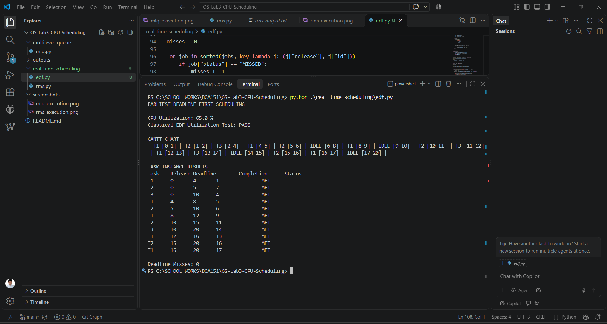

<div align="center">

# OS Laboratory Activity 3
## Multilevel Queue and Real-Time CPU Scheduling

**Mindanao State University – Iligan Institute of Technology**

**College of Computer Studies**  
**Department of Computer Applications**

**BCA151 – Operating Systems Lab**

</div>

---

## Table of Contents

1. [Student Information](#student-information)
2. [I. Introduction](#i-introduction)
3. [II. Objectives](#ii-objectives)
4. [III. Scheduling Algorithms](#iii-scheduling-algorithms)
5. [IV. Program Implementation](#iv-program-implementation)
6. [V. Test Data](#v-test-data)
7. [VI. Results and Discussion](#vi-results-and-discussion)
8. [VII. Algorithm Comparison](#vii-algorithm-comparison)
9. [Guide Questions](#guide-questions)
10. [VIII. Conclusion](#viii-conclusion)
11. [Repository Structure](#repository-structure)

---

## Student Information

| Information | Details |
|-------------|---------|
| Name | BERT ALDE J. ARIAS |
| Course and Section | COMPUTER APPLICATIONS - B186 |
| Instructor | MARIA FE BAHINTING |
| Date Submitted | NOVEMBER 14, 2026 (SAT) |

---

## I. Introduction

This laboratory activity focuses on the implementation and simulation of three CPU scheduling algorithms: Multilevel Queue (MLQ), Rate Monotonic Scheduling (RMS), and Earliest Deadline First (EDF).

The activity demonstrates how processes and periodic tasks are scheduled based on queue priorities, task periods, and absolute deadlines.

Python is used to simulate the scheduling algorithms, generate Gantt charts, and calculate performance metrics such as waiting time, turnaround time, CPU utilization, and deadline compliance.

GitHub is used to organize, manage, and document the source code and laboratory results.

---

## II. Objectives

The objectives of this laboratory activity are to:

1. Explain how MLQ, RMS, and EDF scheduling algorithms work.
2. Implement Multilevel Queue scheduling using Round Robin and FCFS.
3. Develop preemptive RMS and EDF scheduling simulations using Python.
4. Generate and interpret Gantt charts.
5. Calculate CPU utilization, waiting time, turnaround time, and deadline compliance.
6. Manage source code and laboratory documentation using GitHub.

---

## III. Scheduling Algorithms

### A. Multilevel Queue Scheduling (MLQ)

Multilevel Queue scheduling divides processes into separate queues based on their categories and scheduling requirements.

In this simulation, two queues are used:

- **Queue 1:** Interactive processes using Round Robin with a 2 ms time quantum.
- **Queue 2:** Batch processes using First Come, First Served (FCFS).

Queue 1 has higher priority than Queue 2. A newly arriving Queue 1 process can preempt a running Queue 2 process.

### B. Rate Monotonic Scheduling (RMS)

Rate Monotonic Scheduling is a fixed-priority preemptive scheduling algorithm used for periodic real-time tasks.

The task with the shortest period receives the highest priority.

The priority order for the given tasks is:

**T1 > T2 > T3**

Task priorities remain fixed throughout the simulation.

### C. Earliest Deadline First (EDF)

Earliest Deadline First is a dynamic-priority preemptive scheduling algorithm.

It selects the ready task with the earliest absolute deadline.

The absolute deadline is calculated using:

**Absolute Deadline = Release Time + Relative Deadline**

Unlike RMS, EDF determines priorities dynamically based on the deadlines of the available tasks.

---

## IV. Program Implementation

### A. Multilevel Queue Implementation

**Source File:** [mlq.py](multilevel_queue/mlq.py)

The MLQ program implements Round Robin scheduling for Queue 1 and FCFS scheduling for Queue 2.

The program uses a 2 ms quantum for Round Robin and simulates CPU execution in 1 ms intervals.

It records the execution sequence and calculates the completion time, turnaround time, and waiting time of each process.

### B. Rate Monotonic Scheduling Implementation

**Source File:** [rms.py](real_time_scheduling/rms.py)

The RMS program generates periodic task instances based on their execution times, periods, and relative deadlines.

It assigns fixed priorities according to task periods and simulates preemptive CPU scheduling.

The program calculates CPU utilization, compares it with the RMS sufficient utilization bound, and checks whether each task instance meets its deadline.

### C. Earliest Deadline First Implementation

**Source File:** [edf.py](real_time_scheduling/edf.py)

The EDF program generates periodic task instances and selects the ready task with the earliest absolute deadline.

It uses preemptive scheduling and records the execution sequence using a Gantt chart.

The program also calculates CPU utilization and determines the deadline status of each task instance.

All three programs use Python 3 without external libraries.

---

## V. Test Data

### A. Multilevel Queue Process Data

| Process | Arrival Time (ms) | Burst Time (ms) | Queue |
|---------|-------------------|-----------------|-------|
| P1 | 0 | 5 | 1 |
| P2 | 1 | 4 | 1 |
| P3 | 0 | 6 | 2 |
| P4 | 2 | 3 | 2 |
| P5 | 3 | 2 | 1 |

**Round Robin Time Quantum:** 2 ms

### B. RMS and EDF Task Data

| Task | Execution Time (C) | Period (T) | Relative Deadline (D) |
|------|--------------------|------------|-----------------------|
| T1 | 1 ms | 4 ms | 4 ms |
| T2 | 1 ms | 5 ms | 5 ms |
| T3 | 2 ms | 10 ms | 10 ms |

**Simulation Duration:** 20 ms

**Simulation Interval:** 1 ms

**Context-Switching Overhead:** Ignored

---

## VI. Results and Discussion

### A. Multilevel Queue Scheduling Results

#### 1. Execution Screenshot



#### 2. Graphical Gantt Chart

The following diagram represents the execution timeline of the MLQ simulation.

```mermaid
gantt
    title Multilevel Queue Scheduling
    dateFormat x
    axisFormat %L
    tickInterval 2millisecond
    todayMarker off

    section CPU Execution
    P1 [0-2]     : 0, 2
    P2 [2-4]     : 2, 4
    P1 [4-6]     : 4, 6
    P5 [6-8]     : 6, 8
    P2 [8-10]    : 8, 10
    P1 [10-11]   : 10, 11
    P3 [11-17]   : 11, 17
    P4 [17-20]   : 17, 20
```



*Timeline values are in milliseconds (ms).*

#### 3. Process Performance

| PID | AT | BT | CT | TAT | WT |
|-----|----|----|----|-----|----|
| P1 | 0 | 5 | 11 | 11 | 6 |
| P2 | 1 | 4 | 10 | 9 | 5 |
| P3 | 0 | 6 | 17 | 17 | 11 |
| P4 | 2 | 3 | 20 | 18 | 15 |
| P5 | 3 | 2 | 8 | 5 | 3 |

#### 4. Performance Summary

| Metric | Result |
|--------|--------|
| Average Turnaround Time | 12.00 ms |
| Average Waiting Time | 8.00 ms |
| Total Execution Time | 20 ms |
| Round Robin Quantum | 2 ms |

#### 5. Discussion

The results show that Queue 1 processes received higher priority than Queue 2 processes.

P1, P2, and P5 were executed first using Round Robin scheduling with a 2 ms time quantum.

After all Queue 1 processes completed, P3 and P4 were executed using FCFS scheduling.

The simulation produced an average turnaround time of 12.00 ms and an average waiting time of 8.00 ms.

These results demonstrate how queue priority influences the execution order and waiting time of processes.

**Saved Output:** [mlq_output.txt](outputs/mlq_output.txt)

---

### B. Rate Monotonic Scheduling Results

#### 1. Execution Screenshot



#### 2. Graphical Gantt Chart

The following diagram represents the execution timeline of RMS.

```mermaid
gantt
    title Rate Monotonic Scheduling
    dateFormat x
    axisFormat %L
    tickInterval 2millisecond
    todayMarker off

    section CPU Execution
    T1 [0-1]      : 0, 1
    T2 [1-2]      : 1, 2
    T3 [2-4]      : 2, 4
    T1 [4-5]      : 4, 5
    T2 [5-6]      : 5, 6
    IDLE [6-8]    : 6, 8
    T1 [8-9]      : 8, 9
    IDLE [9-10]   : 9, 10
    T2 [10-11]    : 10, 11
    T3 [11-12]    : 11, 12
    T1 [12-13]    : 12, 13
    T3 [13-14]    : 13, 14
    IDLE [14-15]  : 14, 15
    T2 [15-16]    : 15, 16
    T1 [16-17]    : 16, 17
    IDLE [17-20]  : 17, 20
```



*Timeline values are in milliseconds (ms).*

#### 3. CPU Utilization

The CPU utilization is calculated using:

**U = Σ(C / T)**

For the given task set:

U = 1/4 + 1/5 + 2/10

U = 0.25 + 0.20 + 0.20

**CPU Utilization = 65%**

The RMS sufficient utilization bound is calculated using:

**U_bound = n(2^(1/n) - 1)**

For three periodic tasks:

**RMS Utilization Bound = 77.98%**

Since 65% is below 77.98%, the task set passes the sufficient utilization-bound test.

#### 4. Performance Results

| Metric | Result |
|--------|--------|
| Priority Order | T1 > T2 > T3 |
| CPU Utilization | 65.0% |
| RMS Sufficient Utilization Bound | 77.98% |
| Sufficient-Bound Test | PASS |
| Deadline Misses | 0 |

#### 5. Task Instance Results

| Task | Release | Deadline | Completion | Status |
|------|---------|----------|------------|--------|
| T1 | 0 | 4 | 1 | MET |
| T2 | 0 | 5 | 2 | MET |
| T3 | 0 | 10 | 4 | MET |
| T1 | 4 | 8 | 5 | MET |
| T2 | 5 | 10 | 6 | MET |
| T1 | 8 | 12 | 9 | MET |
| T2 | 10 | 15 | 11 | MET |
| T3 | 10 | 20 | 14 | MET |
| T1 | 12 | 16 | 13 | MET |
| T2 | 15 | 20 | 16 | MET |
| T1 | 16 | 20 | 17 | MET |

#### 6. Discussion

RMS uses fixed priorities based on task periods.

T1 received the highest priority because it has the shortest period of 4 ms, followed by T2 with 5 ms and T3 with 10 ms.

The simulation achieved 65% CPU utilization, which is below the RMS sufficient utilization bound of 77.98%.

All generated task instances completed within their deadlines, resulting in zero deadline misses.

The Gantt chart also contains IDLE intervals because no tasks were ready to execute during those periods.

**Saved Output:** [rms_output.txt](outputs/rms_output.txt)

---

### C. Earliest Deadline First Scheduling Results

#### 1. Execution Screenshot



#### 2. Graphical Gantt Chart

The following diagram represents the execution timeline of EDF.

```mermaid
gantt
    title Earliest Deadline First Scheduling
    dateFormat x
    axisFormat %L
    tickInterval 2millisecond
    todayMarker off

    section CPU Execution
    T1 [0-1]      : 0, 1
    T2 [1-2]      : 1, 2
    T3 [2-4]      : 2, 4
    T1 [4-5]      : 4, 5
    T2 [5-6]      : 5, 6
    IDLE [6-8]    : 6, 8
    T1 [8-9]      : 8, 9
    IDLE [9-10]   : 9, 10
    T2 [10-11]    : 10, 11
    T3 [11-12]    : 11, 12
    T1 [12-13]    : 12, 13
    T3 [13-14]    : 13, 14
    IDLE [14-15]  : 14, 15
    T2 [15-16]    : 15, 16
    T1 [16-17]    : 16, 17
    IDLE [17-20]  : 17, 20
```



*Timeline values are in milliseconds (ms).*

#### 3. CPU Utilization

CPU utilization is calculated using:

**U = Σ(C / T)**

U = 1/4 + 1/5 + 2/10

U = 0.25 + 0.20 + 0.20

**CPU Utilization = 65%**

Under the classical single-processor EDF assumptions, a periodic task set with deadlines equal to periods passes the utilization test when CPU utilization does not exceed 100%.

Since 65% is below 100%, the task set passes the classical EDF utilization test.

#### 4. Performance Results

| Metric | Result |
|--------|--------|
| CPU Utilization | 65.0% |
| Classical EDF Utilization Test | PASS |
| Deadline Misses | 0 |

#### 5. Task Instance Results

| Task | Release | Deadline | Completion | Status |
|------|---------|----------|------------|--------|
| T1 | 0 | 4 | 1 | MET |
| T2 | 0 | 5 | 2 | MET |
| T3 | 0 | 10 | 4 | MET |
| T1 | 4 | 8 | 5 | MET |
| T2 | 5 | 10 | 6 | MET |
| T1 | 8 | 12 | 9 | MET |
| T2 | 10 | 15 | 11 | MET |
| T3 | 10 | 20 | 14 | MET |
| T1 | 12 | 16 | 13 | MET |
| T2 | 15 | 20 | 16 | MET |
| T1 | 16 | 20 | 17 | MET |

#### 6. Discussion

EDF dynamically assigns priorities based on absolute deadlines.

Tasks with earlier absolute deadlines receive higher priority and may preempt tasks with later deadlines.

The simulation achieved 65% CPU utilization and passed the classical EDF utilization test.

All generated task instances completed within their deadlines, resulting in zero deadline misses.

For the given task set, RMS and EDF produced the same Gantt chart and execution sequence.

Although both algorithms produced identical results in this simulation, they use different priority assignment methods.

**Saved Output:** [edf_output.txt](outputs/edf_output.txt)

---

## VII. Algorithm Comparison

### A. Scheduling Algorithm Comparison

| Criteria | MLQ | RMS | EDF |
|----------|-----|-----|-----|
| Scheduling Basis | Queue priority | Task period | Absolute deadline |
| Priority Assignment | Fixed queue priority | Fixed task priority | Dynamic task priority |
| Scheduling Type | Depends on queue policy | Preemptive | Preemptive |
| Main Application | Process classification | Periodic real-time tasks | Deadline-based real-time tasks |
| Deadline Monitoring | Not inherent | Yes | Yes |

### B. Comparison Discussion

Multilevel Queue scheduling organizes processes according to their categories and assigns scheduling policies to each queue.

RMS is designed for periodic real-time tasks and uses fixed priorities based on task periods.

EDF is also designed for real-time scheduling but uses dynamic priorities based on absolute deadlines.

In the simulations, both RMS and EDF achieved 65% CPU utilization with zero deadline misses.

These results demonstrate that different scheduling algorithms can produce similar execution sequences under certain task conditions.

---

## Guide Questions

### 1. What is the main difference between Multilevel Queue and Multilevel Feedback Queue scheduling?

Multilevel Queue scheduling assigns processes to fixed queues, while Multilevel Feedback Queue scheduling allows processes to move between queues based on their behavior and CPU usage.

### 2. Why does MLQ use different scheduling algorithms for different process queues?

MLQ uses different scheduling algorithms because processes have different requirements. Interactive processes need faster response times, while batch processes can be handled using FCFS.

### 3. How does RMS determine which task receives the CPU first?

RMS selects the ready task with the shortest period because shorter periods are assigned higher priorities.

### 4. Why is RMS considered a fixed-priority scheduling algorithm?

RMS is considered fixed-priority because each task's priority is determined by its period and remains unchanged during scheduling.

### 5. How does EDF determine which task should execute next?

EDF selects the ready task with the earliest absolute deadline.

### 6. Why is EDF considered a dynamic-priority scheduling algorithm?

EDF is dynamic-priority because task priorities depend on their absolute deadlines and can change when new task instances are released.

### 7. What happens when a newly released task has an earlier deadline than the currently running task under EDF?

The newly released task preempts the currently running task because it has an earlier deadline. The interrupted task can continue later when it becomes the highest-priority ready task.

### 8. Why is CPU utilization important in real-time scheduling?

CPU utilization helps determine whether the processor has enough capacity to execute tasks and meet their deadlines.

### 9. Can a task set with CPU utilization below 100% still miss a deadline? Explain the conditions under which this may happen.

Yes. A task set can still miss deadlines even when CPU utilization is below 100%.

This may happen because of strict deadlines, task blocking, scheduling overhead, or the limitations of the scheduling algorithm.

CPU utilization alone does not guarantee that every deadline will be met under all scheduling conditions.

### 10. Which algorithm would you recommend for periodic real-time tasks, RMS or EDF? Justify your answer.

I would recommend EDF because it dynamically prioritizes tasks based on their deadlines and can achieve higher processor utilization under the classical single-processor scheduling assumptions.

However, RMS is also a good choice when simpler and more predictable fixed-priority scheduling is preferred.

---

## VIII. Conclusion

This laboratory activity demonstrated the implementation and behavior of Multilevel Queue, Rate Monotonic Scheduling, and Earliest Deadline First scheduling algorithms using Python.

Through the simulations, I learned how MLQ organizes processes into different queues, how RMS uses fixed priorities based on task periods, and how EDF dynamically assigns priorities based on deadlines.

The MLQ simulation produced an average turnaround time of 12.00 ms and an average waiting time of 8.00 ms.

Both RMS and EDF achieved 65% CPU utilization and completed all task instances without deadline misses.

Overall, the activity improved my understanding of CPU scheduling, Gantt chart analysis, real-time scheduling, and Python programming. It also provided practical experience in organizing and documenting source code and simulation results using GitHub.

---

## Repository Structure

```text
OS-Lab3-CPU-Scheduling/
|
|-- README.md
|
|-- multilevel_queue/
|   |-- mlq.py
|
|-- real_time_scheduling/
|   |-- rms.py
|   |-- edf.py
|
|-- outputs/
|   |-- mlq_output.txt
|   |-- rms_output.txt
|   |-- edf_output.txt
|
|-- screenshots/
    |-- mlq_execution.png
    |-- rms_execution.png
    |-- edf_execution.png
```

---

<div align="center">

**BCA151 – Operating Systems Lab**

**Mindanao State University – Iligan Institute of Technology**

</div>
